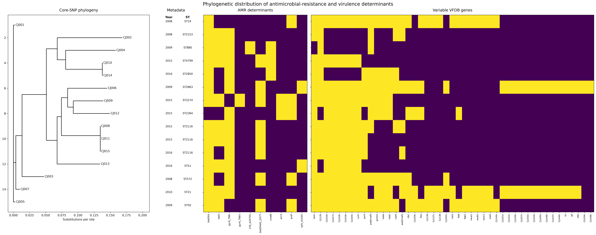

# Campylobacter WGS Comparative Genomics Pipeline

A reproducible bacterial whole-genome sequencing workflow for quality control,
assembly, MLST, antimicrobial-resistance profiling, virulence screening,
recombination-aware core-SNP phylogenetics, and integrated comparative analysis
of poultry-associated *Campylobacter jejuni* isolates.

## Project overview

This project uses a 15-isolate subset of publicly available *Campylobacter
jejuni* Illumina whole-genome sequencing data to demonstrate an end-to-end
comparative genomics workflow. The analysis integrates read quality control,
taxonomic screening, de novo assembly, sequence typing, AMR and virulence
profiling, core-genome SNP analysis, recombination filtering, and
maximum-likelihood phylogenetics.

The project was developed as a reproducible training and portfolio workflow,
with emphasis on quality control, transparent troubleshooting, and biological
interpretation rather than population-level epidemiology.

## Research question

How are antimicrobial-resistance and virulence determinants distributed among
genomic lineages of poultry-associated *Campylobacter jejuni*?

### Working hypothesis

Genetically related isolates are expected to show more similar AMR and
virulence profiles than distantly related isolates, although accessory gene
gain/loss and recombination may introduce within-lineage variation.

## Dataset

The analysis used 15 *C. jejuni* isolates selected from NCBI BioProject
`PRJNA941181`.

- Samples: CJ001–CJ015
- Collection years: 2008–2016
- Host: *Gallus gallus*
- Country: Italy
- Sequencing platform: Illumina NextSeq 500
- Library layout: paired-end
- Sample metadata: [`metadata/sample_metadata.csv`](metadata/sample_metadata.csv)

This subset was selected for workflow development and comparative analysis and
is not intended to represent the full BioProject population.

## Workflow summary

```text
NCBI SRA paired reads
        ↓
fastp + FastQC + MultiQC
        ↓
Kraken2 taxonomic screening
        ↓
SPAdes de novo assembly
        ↓
CJ006 contamination rescue + Mash comparison
        ↓
QUAST assembly QC
        ↓
MLST typing
        ↓
AMRFinderPlus
        ↓
ABRicate + VFDB
        ↓
Snippy variant calling
        ↓
snippy-core
        ↓
Gubbins recombination filtering
        ↓
IQ-TREE maximum-likelihood phylogeny
        ↓
Integrated lineage / AMR / virulence comparison
```

The full runnable workflow is implemented through the scripts in `scripts/`
and the top-level `run_pipeline.sh` orchestrator.

## Key findings

- The 15-isolate subset contained substantial lineage diversity, with 13 MLST
  sequence types. CJ008, CJ011, and CJ015 were all ST-2116 and formed a
  strongly supported core-SNP phylogenetic cluster.
- AMRFinderPlus identified widespread quinolone-resistance-associated
  `gyrA` variation. `gyrA_T86I` was detected in 12/15 isolates, while
  `tet(O)` occurred in 9/15. CJ004 additionally carried `23S_A2075G`.
- VFDB screening identified 128 virulence-associated genes, including 83
  genes shared by all isolates and 45 variable genes, indicating a conserved
  virulence backbone with accessory variation.
- The ST-2116 isolates showed concordance across multiple genomic layers:
  identical MLST type, strong phylogenetic clustering, similar AMR profiles,
  and highly similar virulence profiles.
- CJ006 was a major QC outlier. Its original assembly was ~2.97 Mb with
  43.91% GC and strong *Bifidobacterium pullorum* contamination. Genus-level
  *Campylobacter* read filtering and reassembly produced a ~1.74 Mb assembly
  with 30.12% GC, 29 contigs, and N50 of ~130 kb.
- Gubbins detected heterogeneous recombination across branches, supporting the
  use of a recombination-filtered alignment for final phylogenetic inference.

Overall, the results support the working hypothesis that closely related
isolates tend to share more similar AMR and virulence profiles, while
recombination and accessory gene variation introduce additional differences.

> These observations describe a selected 15-isolate training subset and should
> not be interpreted as population-level prevalence estimates.

## Integrated comparative analysis



The integrated figure combines the recombination-filtered core-SNP phylogeny
with AMR determinants, variable virulence genes, MLST assignments, and sample
metadata.

Additional figures:

- [Core-SNP phylogeny](Figures/core_snp_phylogeny.png)
- [AMR heatmap](Figures/amr_heatmap.png)
- [Variable virulence heatmap](Figures/variable_virulence_heatmap.png)

## Reproducibility

### Main environment

The main analysis environment is defined in `environment.yml`. Create and
activate it with:

```bash
conda env create -f environment.yml
conda activate campy-wgs
```

It includes SRA Toolkit, fastp, FastQC, MultiQC, SeqKit, Kraken2/KrakenTools,
Mash, SPAdes, QUAST, MLST, AMRFinderPlus, Biopython, Matplotlib, and SciPy.
QUAST is installed from PyPI in this environment because the native Apple
Silicon Conda package did not solve in the package check for this workflow.

On Apple Silicon macOS, Snippy, Gubbins, IQ-TREE, and ABRicate were run in
dedicated `osx-64` Conda environments under Rosetta because of package
compatibility constraints. The recorded phylogeny-tool setup was:

```bash
CONDA_SUBDIR=osx-64 conda create -n snippy-env \
  -c conda-forge -c bioconda snippy=4.6.0 -y
CONDA_SUBDIR=osx-64 conda create -n gubbins-env \
  -c conda-forge -c bioconda gubbins -y
CONDA_SUBDIR=osx-64 conda create -n iqtree-env \
  -c conda-forge -c bioconda iqtree -y
```

If installing more packages into one of these environments, scope the
platform setting to that environment:

```bash
conda activate snippy-env
conda config --env --set subdir osx-64
```

ABRicate is used for the VFDB screen and is not in the main environment. Its
dependencies did not solve natively in the checked Apple Silicon Conda setup,
but did solve for `osx-64`. Install it separately and initialize its local
databases:

```bash
CONDA_SUBDIR=osx-64 conda create -n abricate-env \
  -c conda-forge -c bioconda abricate -y
conda activate abricate-env
abricate --setupdb
```

### Run the workflow

The full pipeline requires a Kraken2 database and the reference FASTA:

```bash
KRAKEN_DB=/path/to/kraken2_database \
  ./run_pipeline.sh /path/to/C_jejuni_NCTC11168.fasta
```

Useful options:

```bash
export SKIP_DOWNLOAD=1  # reuse existing raw FASTQ files
export RUN_VFDB=1       # include the optional VFDB screen
export THREADS=8        # set the per-tool thread count
export DRY_RUN=1        # print planned stages without running analyses
```

The VFDB stage is skipped by default and uses the separately configured
`abricate-env` when enabled. The pipeline writes stage-specific analysis
outputs under `results/`, read data under `data/`, and stops if a required
stage fails.

## Individual scripts

The runnable stage scripts are in `scripts/`; shared paths, metadata loading,
and sample-selection helpers are in `scripts/common.sh`. They are intended to
be run from the repository root. The default thread count is 4; set
`THREADS` to override it. `METADATA`, `RAW_DIR`, `TRIMMED_DIR`,
`ASSEMBLY_ROOT`, and `REFERENCE` can also be set to override paths.

| Script | Purpose |
|---|---|
| `scripts/02_download_remaining.sh` | Download mapped SRA runs and create paired FASTQ files |
| `scripts/03_batch_fastp_qc.sh` | Trim reads with fastp; run FastQC and MultiQC |
| `scripts/04_batch_kraken2.sh` | Classify trimmed read pairs with Kraken2 and write a summary |
| `scripts/04b_rescue_CJ006.sh` | Screen, genus-filter, reassemble, and re-screen the CJ006 rescue |
| `scripts/05_batch_mash.sh` | Compare assemblies against the reference and one another |
| `scripts/06_batch_spades.sh` | Assemble trimmed paired reads |
| `scripts/06b_batch_quast.sh` | Evaluate assemblies with QUAST |
| `scripts/07_batch_mlst.sh` | Assign MLST profiles |
| `scripts/08_batch_amrfinder.sh` | Run AMRFinderPlus, including all-mutations output |
| `scripts/09_batch_vfdb.sh` | ABRicate screen of all isolates against VFDB |
| `scripts/10_batch_snippy.sh` | Run reference-based Snippy per sample |
| `scripts/11_batch_phylogeny.sh` | Create Snippy core alignments |
| `scripts/12_batch_gubbins.sh` | Run recombination analysis with Gubbins |
| `scripts/13_batch_iqtree.sh` | Filter to variable sites and run IQ-TREE |

### Run the complete workflow

After installing the Conda environments above, the orchestrator runs the
stages in workflow order and invokes each script in its required environment.
Provide the Kraken2 database path and, if needed, a reference FASTA path:

```bash
KRAKEN_DB=/path/to/kraken2_database \
  ./run_pipeline.sh /path/to/C_jejuni_NCTC11168.fasta
```

The reference argument can be omitted when the reference is at the default
path shown above. `THREADS` defaults to 4. Environment names can be overridden
with `MAIN_ENV`, `SNIPPY_ENV`, `GUBBINS_ENV`, `IQTREE_ENV`, and
`ABRICATE_ENV`. The runner requires `KRAKEN_DB` because it performs both the
routine Kraken2 screen and CJ006 rescue. It writes per-stage logs to
`results/logs/` and stops on the first failed stage.

To print the planned stages without executing them, use
`DRY_RUN=1 ./run_pipeline.sh /path/to/reference.fasta`. This still validates
that the reference file exists.

### Run stages individually

Individual scripts can also be run manually in the Conda environment
appropriate to each stage. For the main environment, run download, read QC,
Kraken2 screening, SPAdes assembly, CJ006 rescue, Mash, QUAST, MLST, and
AMRFinderPlus in the sequence listed by the orchestrator. Run
`09_batch_vfdb.sh` from `abricate-env` for the VFDB screen. Run
`10_batch_snippy.sh` and
`11_batch_phylogeny.sh` in `snippy-env`, followed by `12_batch_gubbins.sh` in
`gubbins-env` and `13_batch_iqtree.sh` in `iqtree-env`.

The CJ006 rescue requires KrakenTools' `extract_kraken_reads.py` and
`KRAKEN_DB`. Downstream scripts select rescued CJ006 reads and assembly when
those outputs exist.

## Workflow

### 1. Read quality control and trimming

fastp trims adapters and filters low-quality or short reads; FastQC and
MultiQC provide per-sample and combined QC reports. The batch script writes
trimmed paired reads under `data/trimmed/`, fastp reports under
`results/fastp/`, FastQC output under `results/fastqc/`, and the combined
report under `results/multiqc/`.

Example fastp settings used:

```bash
fastp \
  -i data/raw/SRR23704524_1.fastq.gz \
  -I data/raw/SRR23704524_2.fastq.gz \
  -o data/trimmed/CJ001_R1.fastq.gz \
  -O data/trimmed/CJ001_R2.fastq.gz \
  --detect_adapter_for_pe \
  --qualified_quality_phred 20 \
  --length_required 50 \
  --html results/fastp/CJ001/fastp.html \
  --json results/fastp/CJ001/fastp.json \
  --thread 4
```

Run `./scripts/03_batch_fastp_qc.sh` for all samples.

### 2. Contamination screening and CJ006 troubleshooting

Kraken2 read-level classification is run with
`KRAKEN_DB=/path/to/database ./scripts/04_batch_kraken2.sh`. Per-sample reports
and classification files are written to `results/kraken2_batch/`, together
with `kraken2_summary.csv`.

#### CJ006 contamination discovery and rescue

The initial CJ006 assembly was ~2.97 Mbp, unusually large for the expected
*Campylobacter* genome, with 43.91% GC, 1,402 contigs, and an N50 of
91,771 bp. Assembly-level Kraken2 classification assigned 61.25% of contigs
to *Bifidobacterium pullorum* and 1.51% to *Campylobacter*, prompting
read-level screening and targeted reassembly.

Kraken2 processed 976,004 paired read records (287.85 Mbp); 884,318 were
classified (90.61%). KrakenTools `extract_kraken_reads.py` was used with taxid
`194` (*Campylobacter*) and `--include-children`, retaining 867,149 read pairs.
These reads were reassembled with SPAdes into
`results/assembly_batch/CJ006_clean/`. The resulting assembly was 1.74 Mbp.

The rescued assembly was approximately 1.74 Mb, 30.12% GC, 29 contigs, and
N50 130,036 bp. Kraken2 classified the rescued assembly as predominantly
*Campylobacter* and no longer showed the strong *Bifidobacterium* signal.
Because the extraction retained the whole genus, it does not establish that
CJ006 is a pure *C. jejuni* isolate; review the post-rescue taxonomic report
before treating it as a confirmed single-species sample.

Run the scripted rescue after initial assembly:

```bash
KRAKEN_DB=/path/to/kraken2_database ./scripts/04b_rescue_CJ006.sh
```

The script writes read and assembly classifications under
`results/kraken2_assembly/`, retained paired reads under
`results/decontamination/CJ006/`, and the rescued assembly under
`results/assembly_batch/CJ006_clean/`.

### 3. Reference similarity and strain grouping

Mash sketches the reference and assemblies, compares each assembly to
`C_jejuni_NCTC11168.fasta`, and produces pairwise distances among isolates:

```bash
./scripts/05_batch_mash.sh
```

Outputs are in `results/phylogeny/reference_check/`. The recorded
reference-similarity check found CJ015 to be the best central candidate, and
the isolates were reported as genetically close to the NCTC11168 reference.

### 4. De novo assembly

SPAdes runs in isolate mode on paired trimmed reads:

```bash
./scripts/06_batch_spades.sh
```

Typical outputs are `contigs.fasta`, `scaffolds.fasta`, and SPAdes logs under
`results/assembly_batch/CJxxx/`. When CJ006 rescued reads are present, the
rescue script instead writes its assembly to
`results/assembly_batch/CJ006_clean/`.

### 5. Assembly evaluation, typing, and AMR

QUAST evaluates assembly metrics; MLST assigns sequence types:

```bash
./scripts/06b_batch_quast.sh
./scripts/07_batch_mlst.sh
```

Run AMRFinderPlus with the options used in the successful recorded analysis:

```bash
./scripts/08_batch_amrfinder.sh
```

The per-sample command uses `-O Campylobacter`, `--plus`, `--mutation_all`,
and the long-form `--output` option. CJ006 uses the rescued assembly if it is
available. Outputs are written under `results/amrfinder_batch/CJxxx/`;
assembly metrics are in `results/quast_batch/` and MLST results in
`results/mlst_batch/mlst_results.tsv`.

### 6. Virulence screening against VFDB

ABRicate/VFDB screening was performed across all 15 isolates. The analysis
used `--db vfdb --minid 80 --mincov 80`. Repository analysis products include
`Results/virulence_gene_frequency.tsv`,
`Figures/variable_virulence_heatmap.png`, and
`Figures/integrated_phylogeny_amr_virulence_v2.png`. AMRFinderPlus AMR
profiling is separate from this dedicated virulence-gene screen.

With ABRicate installed and its VFDB database initialized, run:

```bash
./scripts/09_batch_vfdb.sh
```

The script uses the same database and thresholds as the completed analysis:
`--db vfdb --minid 80 --mincov 80`. Per-sample candidate matches and the
combined ABRicate summary are written under `results/virulence/vfdb/`.
Database hits alone do not establish gene expression, functionality, or
virulence phenotype.

### 7. Reference-based variant calling

Snippy maps reads to the reference and calls/filter variants. Run:

```bash
conda activate snippy-env
./scripts/10_batch_snippy.sh
```

The script writes per-sample results under `results/snippy/CJxxx/`, including
Snippy VCF, alignment, consensus, BAM, and tabular outputs. CJ006 uses the
retained genus-filtered reads when its rescue reads are present.

### 8. Core alignment and recombination-aware phylogeny

With the Snippy environment active, create the core alignment:

```bash
./scripts/11_batch_phylogeny.sh
```

Snippy-core writes `results/phylogeny/core/core.full.aln`,
`core.aln`, `core.txt`, and `core.vcf`. The script only creates these core
alignments; Gubbins and IQ-TREE are separate stages for use in their dedicated
environments.

Run Gubbins in its dedicated environment with
`scripts/12_batch_gubbins.sh`. It processes the full core alignment, collects
tree outputs, and produces the recombination-filtered polymorphic-sites
alignment at `results/phylogeny/gubbins/campy.filtered_polymorphic_sites.fasta`:

```bash
conda activate gubbins-env
./scripts/12_batch_gubbins.sh
```

The IQ-TREE analysis uses the Gubbins-filtered alignment, not the unfiltered
Snippy core alignment. The script excludes the `Reference` record, extracts
variable nucleotide sites from the remaining taxa, then runs IQ-TREE with
ascertainment-bias correction. This follows the final analysis sequence:
Snippy core alignment → Gubbins recombination filtering →
`campy.filtered_polymorphic_sites.fasta` → remove `Reference` → variable sites
only → IQ-TREE `+ASC`.

An initial `+ASC` attempt on `campy_filtered_15.fasta` failed because the
alignment contained 94 invariant sites. The successful analysis used a
variable-sites alignment; the script below recreates that filtering from the
Gubbins output and writes
`results/phylogeny/iqtree/campy.filtered_polymorphic_sites.varsites.fasta`:

```bash
conda activate iqtree-env
./scripts/13_batch_iqtree.sh
```

This used ModelFinder with ascertainment-bias correction (`+ASC`), 1,000
ultrafast bootstrap replicates (`-B 1000`), and 1,000 SH-aLRT replicates
(`-alrt 1000`). The selected model by BIC was `TVM+F+ASC+R2`. The principal
outputs were `campy_final.treefile`, `campy_final.contree`, and
`campy_final.iqtree` under `results/phylogeny/iqtree/`.

## Detailed results

A more complete quantitative interpretation of assembly QC, AMR determinants,
virulence-gene distribution, recombination, and phylogenetic structure is
available in [`RESULTS.md`](RESULTS.md).

## Limitations

- The analysis uses a selected 15-isolate subset and is not intended for
  population-level prevalence estimates.
- AMR results are genotype-based and were not validated against phenotypic
  antimicrobial susceptibility measurements.
- VFDB matches indicate sequence similarity to virulence-associated genes and
  do not demonstrate expression or virulence phenotype.
- The phylogeny is reference-based and recombination-filtered; branch
  relationships indicate genomic relatedness within this dataset, not direct
  transmission or ancestry.
- CJ006 was rescued by genus-level filtering, which substantially reduced
  contamination but does not prove complete single-species purity.

## Main tools

- fastp
- FastQC / MultiQC
- Kraken2 / KrakenTools
- Mash
- SPAdes
- QUAST
- MLST
- AMRFinderPlus
- ABRicate / VFDB
- Snippy
- Gubbins
- IQ-TREE
- Python / Biopython / Matplotlib / SciPy

## Repository structure

```text
WGS-Phylogenetics-Pipeline/
├── README.md
├── RESULTS.md
├── environment.yml
├── run_pipeline.sh
├── metadata/
│   └── sample_metadata.csv
├── scripts/
│   ├── 02_download_remaining.sh
│   ├── 03_batch_fastp_qc.sh
│   ├── 04_batch_kraken2.sh
│   ├── 04b_rescue_CJ006.sh
│   ├── 05_batch_mash.sh
│   ├── 06_batch_spades.sh
│   ├── 06b_batch_quast.sh
│   ├── 07_batch_mlst.sh
│   ├── 08_batch_amrfinder.sh
│   ├── 09_batch_vfdb.sh
│   ├── 10_batch_snippy.sh
│   ├── 11_batch_phylogeny.sh
│   ├── 12_batch_gubbins.sh
│   ├── 13_batch_iqtree.sh
│   └── common.sh
├── Results/
│   ├── mlst_results.tsv
│   ├── amr_summary.tsv
│   ├── virulence_gene_frequency.tsv
│   ├── core.txt
│   └── campy_final.treefile
└── Figures/
    ├── core_snp_phylogeny.png
    ├── amr_heatmap.png
    ├── variable_virulence_heatmap.png
    └── integrated_phylogeny_amr_virulence_v2.png
```

`Results/` contains the curated result summaries and tree shown in this
repository. The runnable pipeline writes its stage outputs under lowercase
`results/` and reads/writes sequencing data under `data/`.
